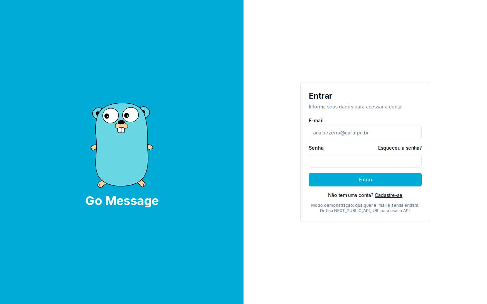
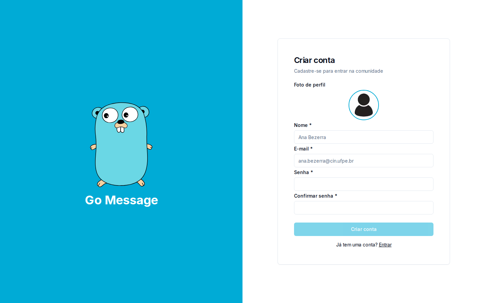
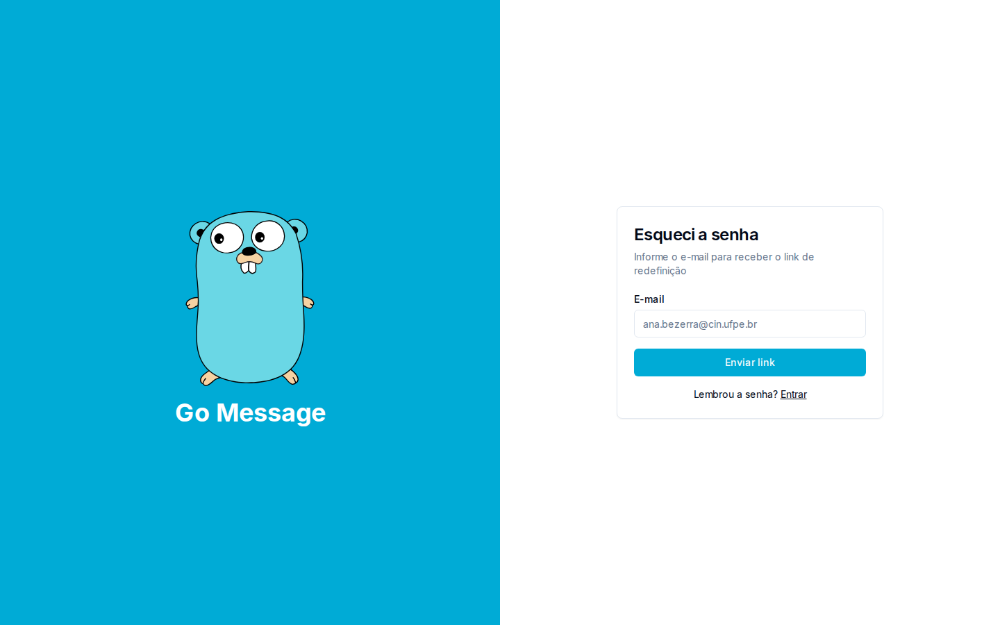
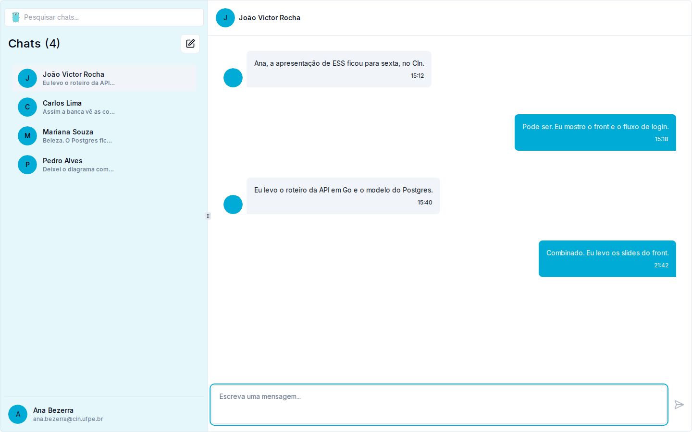
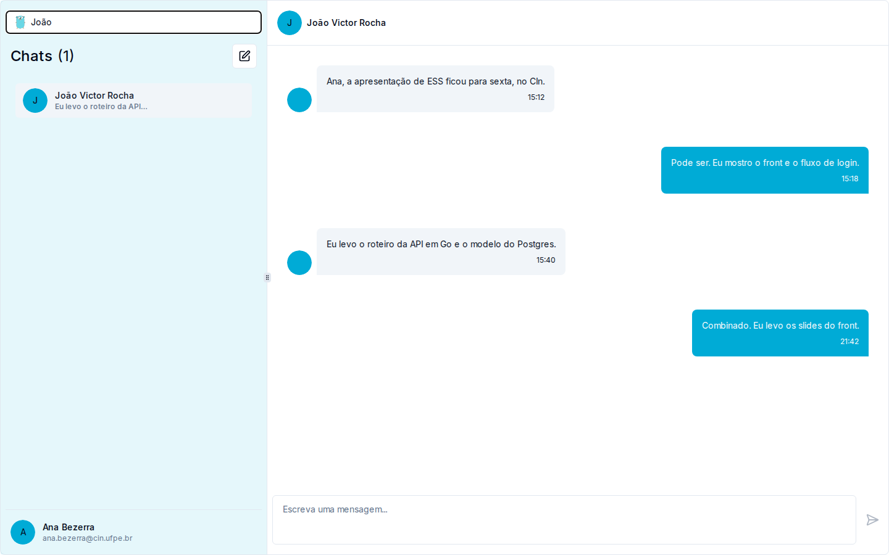
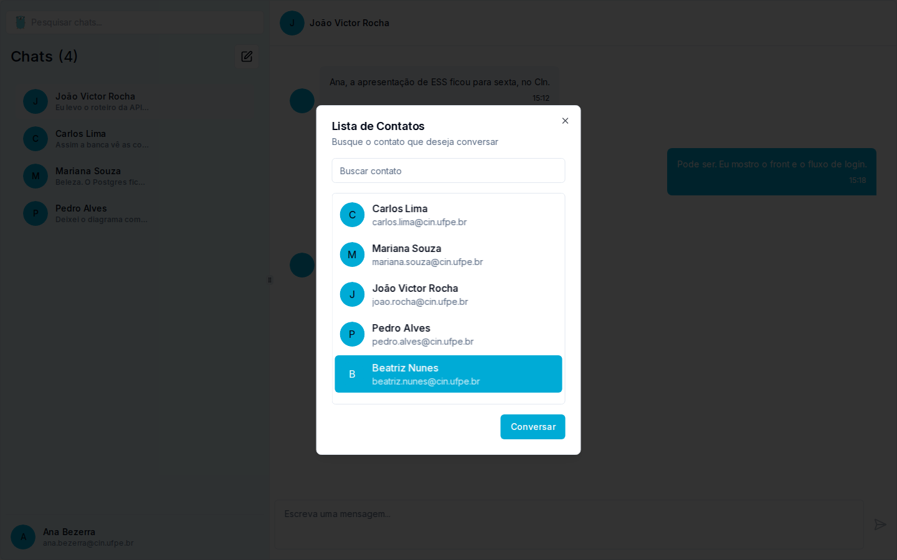
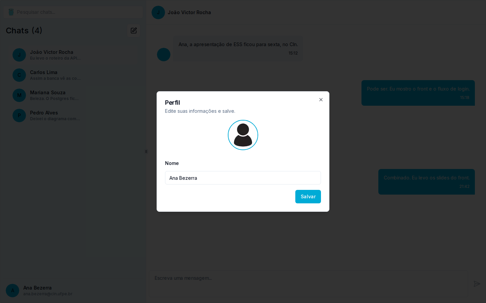
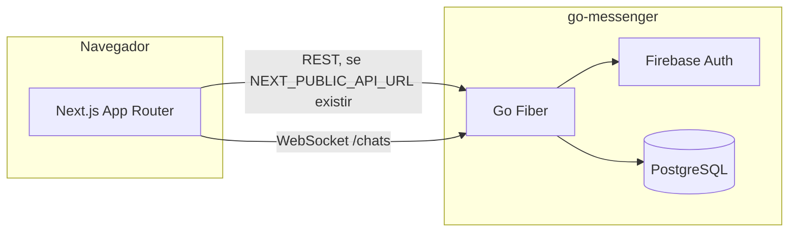

# Go Message

Interface web do **Go Message**, o mensageiro do trabalho de **Engenharia de Software e Sistemas** do Centro de Informática (CIn) da UFPE, em dezembro de 2024. A pessoa entra, vê as conversas e troca mensagens. O serviço por trás é a API em Go do repositório [iianmelo/go-messenger](https://github.com/iianmelo/go-messenger).

Este repositório é um fork de [felipetmacedo/go-messager-ui](https://github.com/felipetmacedo/go-messager-ui), o projeto-base de front-end da disciplina. O histórico da base (login, cadastro, lista de chats, perfil e integração com a API) permanece no upstream.

## Stack

- [Next.js 14](https://nextjs.org/docs) (App Router) e React 18
- [Tailwind CSS](https://tailwindcss.com/) e [shadcn/ui](https://ui.shadcn.com/)
- Axios para o HTTP
- Zustand para o estado da conversa aberta
- Playwright e Cucumber para os testes de aceitação que já vinham na base

A API companheira usa Go com Fiber, autenticação no Firebase e PostgreSQL.

## Telas

Entrar. Sem `NEXT_PUBLIC_API_URL`, qualquer e-mail e senha abrem a demonstração.



Cadastro.



Recuperação de senha.



Conversas, com os dados de demonstração em português.



Pesquisa por nome na lista.



Contatos para começar uma conversa.



Perfil da conta logada.



## Como executar

É preciso Node.js 20 ou superior.

```bash
git clone https://github.com/iianmelo/go-messager-ui.git
cd go-messager-ui
npm install
npm run dev
```

A aplicação sobe em [http://localhost:8080](http://localhost:8080). A raiz redireciona para `/signin`.

Sem variável de ambiente, o login não chama a rede. O cliente usa dados locais (Ana Bezerra e as conversas acima) para a demonstração funcionar sozinha. Para falar com a API:

```bash
cp .env.example .env.local
```

```bash
NEXT_PUBLIC_API_URL=https://seu-host-da-api
NEXT_PUBLIC_WS_URL=wss://seu-host-da-api/chats
```

`NEXT_PUBLIC_API_URL` é a base do Axios (`POST /auth`, usuários e chats). `NEXT_PUBLIC_WS_URL` é opcional; se ficar vazio e a API for `http` ou `https`, o socket é montado no mesmo host, em `/chats`. No modo demonstração o WebSocket não abre.

Build e servidor de produção:

```bash
npm run build
npm start
```

`npm start` escuta a porta 3000.

Os testes de aceitação da base:

```bash
npx cucumber-js
```

## Arquitetura

O navegador renderiza o Next.js. Com a URL da API definida, o login, o perfil, a lista de usuários e os chats saem por HTTP, e as mensagens novas seguem por WebSocket. A API em Go autentica no Firebase e persiste no PostgreSQL. Sem a URL, o próprio front responde com o adaptador de demonstração e nada disso é chamado.



## Publicação

O endereço antigo [go-message-iota.vercel.app](https://go-message-iota.vercel.app) responde 404 com `x-vercel-error: DEPLOYMENT_NOT_FOUND`: o deployment da Vercel associado a esse alias não existe mais. Não é uma rota da aplicação. Além disso, o `yarn.lock` que estava no repositório não batia com o `package.json` (`next` 14.2.25 no lock, 14.0.2 no manifesto). A Vercel prefere o Yarn quando os dois locks existem e instala com lock congelado, então o build nem chegava a gerar um deployment. Os locks foram regenerados para o `package.json` atual. Um novo deploy na Vercel precisa ser criado à parte; o código não recria um projeto apagado.

## Contexto

Trabalho da disciplina **Engenharia de Software e Sistemas**, CIn-UFPE, dezembro de 2024. A base de front-end foi publicada por Felipe Macedo em [felipetmacedo/go-messager-ui](https://github.com/felipetmacedo/go-messager-ui). A API está em [iianmelo/go-messenger](https://github.com/iianmelo/go-messenger).
